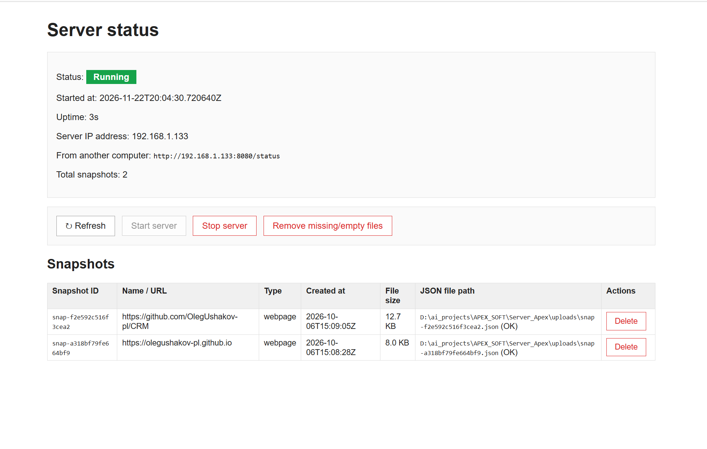

# FastAPI Server for Storing Snapshots

## Overview

Server-side component of the system that receives and stores "snapshot" data from the ApexShot application (FastAPI):
- **ApexShot**: the "Send" button on the Search page (`POST /api/snapshots/{id}/send`) sends the snapshot JSON to `POST /api/add-snapshot` (the Server URL is configured in ApexShot → Settings → Server URL, e.g. `http://localhost:8080/api/add-snapshot`)
- **Compatibility**: the `/api/add-snap` (web pages) and `/api/add-folder-snap` (folders) endpoints are kept for backward compatibility

## Installation

### Requirements

- Python 3.14+
- pip
- SQLite with FTS5 (included in the standard Python build)

### Installing dependencies

```bash
pip install -r requirements.txt
```

### Starting the server

```bash
uvicorn main:app --reload --host 0.0.0.0 --port 8080
```

Or simply:

```bash
python main.py
```

The server will be available at `http://localhost:8080`

## API

### GET /

Server health check.

**Response:**
```json
{
  "message": "Server is running.",
  "endpoints": {
    "/api/add-snap": "Stores a web page snapshot",
    "/api/add-folder-snap": "Stores a local folder snapshot",
    "/api/add-snapshot": "Stores an arbitrary snapshot (ApexShot)",
    "/api/search?q=...": "FTS5 search across snapshots",
    "/api/snaps/{snap_id}": "Get a snapshot by id"
  }
}
```

### POST /api/add-snap

Stores a new **web page** snapshot.

**Request (web page):**
```json
{
  "source_url": "https://example.com/page",
  "thumbnail_base64": "data:image/png;base64,iVBOR...",
  "binary_data": "{\"type\": \"text\", \"content\": \"Hello\"}",
  "metadata_ai": {
    "tags": ["news", "article"],
    "sentiment": 0.8,
    "summary": "Short description...",
    "category": "tech"
  }
}
```

**Success response:**
```json
{
  "status": "success",
  "snap_id": "a1b2c3d4-e5f6-7890-abcd-ef1234567890",
  "message": "Web snapshot has been successfully saved on the server."
}
```

### POST /api/add-folder-snap

Stores a new **local folder** snapshot.

**Request (folder):**
```json
{
  "source_url": "file:///C:/Users/You/Documents/my-folder",
  "thumbnail_base64": "",
  "binary_data": "0101...",
  "metadata_ai": {
    "tags": ["folder", "documents"],
    "sentiment": 0.5,
    "summary": "Folder with documents",
    "category": "other",
    "files": [
      "report.pdf",
      "notes.txt",
      "budget.xlsx"
    ]
  }
}
```

**Success response:**
```json
{
  "status": "success",
  "snap_id": "b2c3d4e5-f6g7-8901-bcde-fg2345678901",
  "message": "Folder snapshot has been successfully saved on the server."
}
```

## Data structure

Each snapshot is saved as a separate JSON file named `uuid.json` in the `uploads/` folder
and is also stored in SQLite (`snaps.db`): the `snaps` table plus an FTS5 index `snaps_fts`
over the `snap_id, url, search_text` fields.

### Web page:
```json
{
  "id": "a1b2c3d4-e5f6-7890-abcd-ef1234567890",
  "type": "web",
  "url": "https://example.com/page",
  "thumbnail": "data:image/png;base64,...",
  "binary_data": "{\"type\": \"text\", ...}",
  "metadata": {
    "tags": ["news", "article"],
    "sentiment": 0.8,
    "summary": "Short description...",
    "category": "tech"
  }
}
```

### Local folder:
```json
{
  "id": "b2c3d4e5-f6g7-8901-bcde-fg2345678901",
  "type": "folder",
  "url": "file:///C:/Users/You/Documents/my-folder",
  "thumbnail": "",
  "binary_data": "0101...",
  "metadata": {
    "tags": ["folder", "documents"],
    "sentiment": 0.5,
    "summary": "Folder with documents",
    "category": "other",
    "files": [
      "report.pdf",
      "notes.txt",
      "budget.xlsx"
    ]
  }
}
```

### POST /api/add-snapshot

Accepts arbitrary JSON (this is where the Send button in ApexShot sends data — the Server URL field).

**Request:** any ApexShot snapshot JSON object (`id`, `directory`, `title`, `summary`, `tags`, ...).

**Success response:**
```json
{
  "status": "success",
  "snap_id": "snap-...",
  "message": "Snapshot has been saved on the server."
}
```

### GET /api/search?q=...&type=...&limit=20&offset=0

FTS5 search across snapshots (url + text). Without `q` — the latest snapshots.

Returns lightweight items (`id`, `type`, `url`, `created_at`, `snippet` — the first
200 characters, without the full `metadata`) so that lists/extensions load quickly:

```json
{
  "total": 1, "limit": 20, "offset": 0,
  "items": [
    {
      "id": "snap-...",
      "type": "apex",
      "url": "C:/docs/project",
      "created_at": "2026-10-06T15:03:08Z",
      "snippet": "hello edge ..."
    }
  ]
}
```

The full snapshot is available via `GET /api/snaps/{snap_id}`.

### GET /api/snaps/{snap_id}

Get a snapshot from SQLite by id.

### DELETE /api/snaps/{snap_id}

Deletes the snapshot entirely: the SQLite record, the FTS index entry, and the JSON file in `uploads/`.
Returns 404 if the snapshot does not exist.

### POST /api/prune-missing

Deletes all records whose JSON file in `uploads/` is missing or empty (0 bytes).

**Response:**
```json
{ "status": "ok", "removed": 2, "ids": ["snap-...", "snap-..."] }
```

The `Delete` buttons (in each row) and `Remove missing/empty files` are available on the `/status` page.

## Project structure

```
server_project/
├── main.py          # Main FastAPI + SQLite FTS5 application file
├── snaps.db         # SQLite snapshot database (created automatically)
├── uploads/         # Folder for storing snapshots (created automatically)
└── README.md        # Documentation
```

## Configuration

### Server port

Change the port in the startup command:
```bash
uvicorn main:app --reload --host 0.0.0.0 --port 8081
```

### Storage folder

By default, `uploads/` is used. Change the `UPLOAD_DIR` variable in `main.py`:
```python
UPLOAD_DIR = "my_snapshots"  # instead of "uploads"
```

## Supported snapshot types

| Type | Endpoint | Example URL |
|------|----------|-------------|
| Web page | `/api/add-snap` | `https://example.com/page` |
| Local folder | `/api/add-folder-snap` | `file:///C:/Users/You/Documents/my-folder` |
| Arbitrary (ApexShot) | `/api/add-snapshot` | `http://localhost:8080/api/add-snapshot` |

## License

This project is licensed under the **GNU Affero General Public License v3.0** (AGPL-3.0-only).
See the [LICENSE](LICENSE) file for the full text.

If you run a modified version of this server as a network service, the AGPL requires you to make
the source code of your modified version available to its users.

Copyright (C) 2026 Oleg Ushakov
